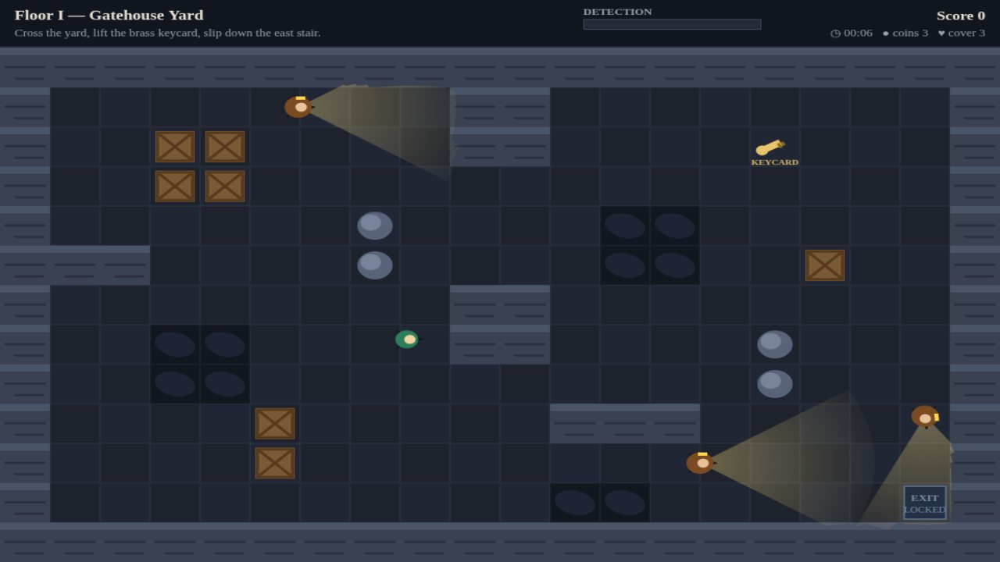

# Night Ledger — a stealth burglary in three floors

An original top-down **stealth game** for the make.fun bounty
[“Make the best stealth game”](https://make.fun/bounty/best-stealth-game-20261121-1759).
You are a burglar in the moonlit Meridian Archive. On each of three floors:
lift the brass **keycard**, reach the **EXIT stair**, and do it **unseen**.

## How to play

Open `game/index.html` in a desktop browser (or run `node serve.ts` and open
http://localhost:8080). It plays fully offline — no network request, no build
step, no dependencies.

- **WASD / arrow keys** — move
- **Shift** — sneak: slower, quieter, and harder to see
- **Mouse click** — throw a coin: wardens who hear it come to look
- **R** — restart the floor · **P** — pause · **M** — mute

## The stealth systems

- **Vision cones** swing with every warden's patrol, pause and scan — and are
  cut short by walls, crates and pillars, so cover really is cover.
- A **detection meter** fills while you are seen (faster up close, slower
  while sneaking or standing in **moonshadow**), drains when you break sight.
- Wardens run four states: **calm** patrol, **suspicious** investigation
  (they also hear footsteps — walking close by is loud), full **alert** chase,
  and **distracted** by a thrown coin.
- Being caught costs one of three **covers** and puts you back at the floor
  entrance; lose the last one and the ledger closes.
- Scoring rewards the keycard, fast clear times, unspent coins — and a
  **ghost bonus** for a floor finished without ever being detected.

## Layout

- `main.ts` — the entrypoint: copies `game/` and `screenshots/` to the
  output directory and writes `dossier.json` with the vendored kit library.
- `game/` — the playable game as static files (`index.html` plus ES modules
  under `game/src/`, one clear job each: levels, simulation, rendering,
  input, sound).
- `screenshots/` — four real renders of the game, taken from its own
  deterministic `?shot=` scenes.
- `vendor/makefun-game.ts` — the kit's dossier library, unchanged.

## Licence

MIT — see `LICENSE`.
